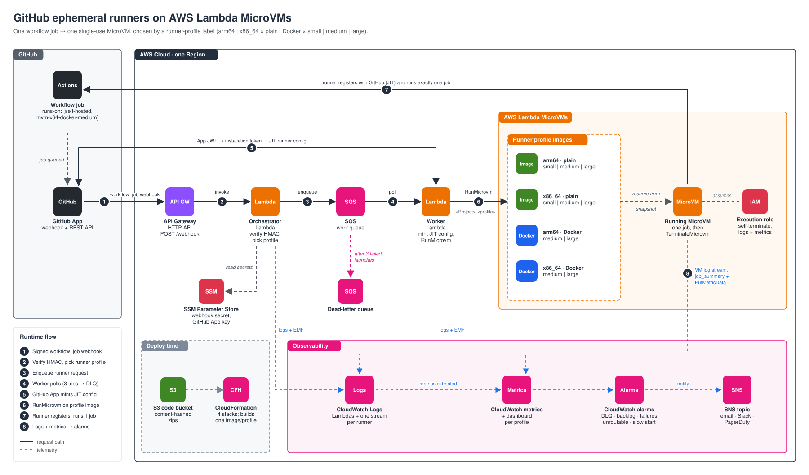
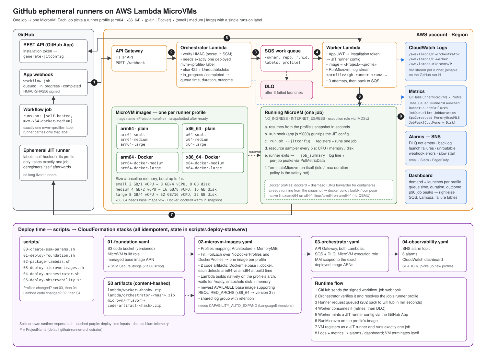
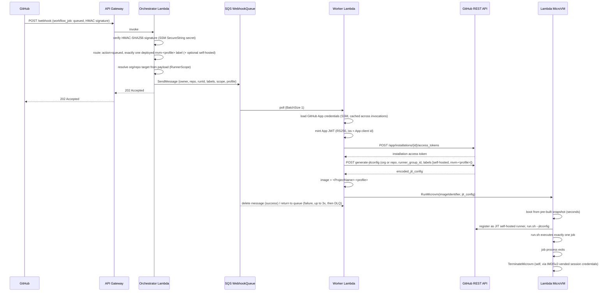

# GitHub Ephemeral Runner Orchestrator

Ephemeral, single-use GitHub Actions self-hosted runners on [AWS Lambda MicroVMs](https://docs.aws.amazon.com/lambda/latest/dg/microvms-how-it-works.html), provisioned on demand by a GitHub webhook and deployed with plain **AWS CloudFormation**.

When a workflow needs a runner, GitHub sends a `workflow_job` webhook. A fresh MicroVM boots from a pre-built snapshot in a few seconds, registers itself with GitHub as a [just-in-time (JIT) runner](https://docs.github.com/en/rest/actions/self-hosted-runners#create-configuration-for-a-just-in-time-runner-for-an-organization), runs **exactly one job**, and self-terminates. There are no long-lived runners, no shared state between jobs, and no idle compute.

This project builds on AWS's own [Lambda MicroVMs documentation](https://docs.aws.amazon.com/lambda/latest/dg/microvms-how-it-works.html) and [aws/agent-toolkit-for-aws's `aws-lambda-microvms` skill](https://github.com/aws/agent-toolkit-for-aws/blob/main/skills/specialized-skills/serverless-skills/aws-lambda-microvms/SKILL.md), with these additions:

- **Both org-level and repo-level runners**, selected with a single `RunnerScope` parameter — the reference implementation only supports organization-level runners.
- **arm64 and x86_64 runners, with or without Docker, in several sizes** — each combination is a *runner profile* that a job picks with one short label, e.g. `runs-on: [self-hosted, mvm-x64-docker-medium]`. See [Choosing a runner](#choosing-a-runner-architecture-docker-size).
- **Observability** — job queue time, duration and outcome per profile, in-VM CPU/memory/disk usage per profile (for right-sizing), launch failures, alarms and a dashboard. See [Observability](#observability).

## What's new: x86_64 runners

AWS Lambda MicroVMs now supports **x86_64** as well as arm64 ([managed base image version 3](https://docs.aws.amazon.com/lambda/latest/dg/microvms-base-image-release-notes.html#microvms-base-image-release-notes-v3)). This release builds on that:

- **x86_64 and arm64 runners side by side.** Each MicroVM image has one fixed architecture, so every architecture × flavor × size combination is its own *runner profile* image, defined in one table in `cloudformation/02-microvm-images.yaml`. Both Dockerfiles detect the architecture they are built on, so one Dockerfile serves both. `linux/amd64` Docker images now build natively on `mvm-x64-*` runners — no QEMU.
- **Short, self-contained runner labels.** Jobs use exactly one label, `mvm-<profile>`. Every runner is registered with only `[self-hosted, mvm-<profile>]`, so a runner can only take jobs for its own profile and a job without a profile label can never take another job's runner.
- **Sizes per profile.** small / medium / large (2 / 4 / 8 GB baseline, each bursting to 4×), with the medium profiles built by default.
- **Ubuntu 26.04 LTS runner images** that apply all pending OS security updates at build time, plus `FORCE_REBUILD=1` to re-patch unchanged images on a schedule.
- **Observability.** Per-profile queue time, duration, outcome, in-VM CPU/memory/disk peaks for right-sizing, launch failures, alarms (SNS) and a CloudWatch dashboard.
- **Hardening.** IAM pinned to the exact deployed image ARNs; the runner's execution role can only write its own log group and a dedicated metrics namespace; deploy scripts refuse to run on stale state.

Check that x86_64 is offered in your Region before enabling `x64-*` profiles: `aws lambda-microvms list-managed-microvm-image-versions --image-identifier arn:aws:lambda:<region>:aws:microvm-image:al2023-1` must list version 3 or later (`scripts/03-deploy-microvm-images.sh` checks this for you and picks the newest suitable version). **Upgrading an existing deployment?** See [Upgrading from the two-image version](#upgrading-from-the-two-image-docker-label-version).

## Architecture

**Overview** (generated by [`docs/diagrams/architecture_overview.py`](docs/diagrams/architecture_overview.py)):



**In detail** — every step, the profile sizes, what happens inside a running MicroVM, and the deploy-time stacks:



([PNG version](docs/architecture.png))

End-to-end sequence, including the parts that matter for debugging (which stage minted which token, when the MicroVM terminates itself and how):



1. **GitHub** sends a `workflow_job` webhook (HMAC-SHA256 signed) when a job is queued.
2. **API Gateway** (HTTP API) exposes `POST /webhook` and invokes the Orchestrator Lambda.
3. **Orchestrator Lambda** verifies the webhook signature, accepts queued `workflow_job` events whose labels are exactly one deployed `mvm-<profile>` label (plus an optional `self-hosted`), resolves the org/repo to register against, and enqueues a runner request. It also turns `in_progress`/`completed` events for those jobs into queue-time, duration and outcome metrics. It responds in milliseconds so GitHub's webhook delivery never blocks on provisioning.
4. **SQS** decouples acceptance from provisioning and gives you retries plus a dead-letter queue for requests that fail 3 times.
5. **Worker Lambda** consumes the queue, mints a [JIT runner token](https://docs.github.com/en/rest/actions/self-hosted-runners) from your GitHub App for a runner labelled only `[self-hosted, mvm-<profile>]`, and calls `RunMicrovm` on the profile's image, with the VM's log stream named after the runner.
6. **Lambda MicroVM** boots from a pre-built snapshot (seconds, not minutes), registers with GitHub as a JIT self-hosted runner, executes the single workflow job while sampling its own CPU/memory/disk use, and calls `TerminateMicrovm` on itself when the job process exits.

## Project layout

```
cloudformation/
  01-foundation.yaml     Phase A: S3 code bucket + MicroVM build role (always deployable)
  02-microvm-images.yaml Phase A2: runner profiles + one MicroVM image per enabled profile
  03-orchestrator.yaml   Phase B: SQS, MicroVM execution role, both Lambdas, API Gateway
  04-observability.yaml  Phase C: alarms (SNS) + CloudWatch dashboard
lambda/
  orchestrator/          Webhook receiver (index.js, filter.js, metrics.js)
  worker/                JIT token mint + RunMicrovm (index.js, github.js, microvms.js, metrics.js)
microvm/
  Dockerfile.base        Plain runner image (no Docker), Ubuntu 26.04 LTS, arm64 + x86_64
  Dockerfile.docker      Docker-in-Docker runner image, Ubuntu 26.04 LTS, arm64 + x86_64
  app.js                 Lifecycle hook server + resource sampler baked into every image (port 9000)
  entrypoint.sh          Passes the JIT config to the GitHub Actions runner's run.sh
docs/
  architecture-overview.svg/.png  Overview diagram (regenerate: python3 docs/diagrams/architecture_overview.py)
  architecture.svg / .png       Detailed hand-drawn flow diagram
examples/workflows/
  microvm-runner-smoke.yml      Smoke test for every default profile (copy into a repo using the runners)
.claude/skills/github-runner-microvm/
  SKILL.md                      Claude Code project skill: pick runs-on labels, add profiles,
                                deploy in the right order, troubleshoot (references/troubleshooting.md)
scripts/
  00-create-ssm-params.sh       Create the two required SSM SecureString parameters
  01-deploy-foundation.sh       Deploy 01-foundation.yaml
  02-package-lambdas.sh         Zip + upload both Lambda functions
  03-deploy-microvm-images.sh   Upload the MicroVM code artifact(s) and deploy 02-microvm-images.yaml
  04-deploy-orchestrator.sh     Deploy 03-orchestrator.yaml
  05-deploy-observability.sh    Deploy 04-observability.yaml
```

## How the MicroVM images are built

Every runner image is an `AWS::Lambda::MicrovmImage` resource in `cloudformation/02-microvm-images.yaml` — ordinary CloudFormation, same as everything else in this project. A MicroVM image has one fixed CPU architecture and one fixed baseline size, so the template builds **one image per enabled runner profile**, named `<ProjectName>-<profile>`, using `Fn::ForEach` (the `AWS::LanguageExtensions` transform) over the `NoDockerProfiles` and `DockerProfiles` parameter lists. Each profile's architecture and baseline memory come from the `Profiles` mapping at the top of the template.

There are still only two code artifacts — one per flavor. `scripts/03-deploy-microvm-images.sh` zips the Dockerfile + `app.js` + `entrypoint.sh` for each flavor, uploads it to S3 under a content-hashed key, picks the newest `AVAILABLE` version of the AWS-managed base image that supports every architecture in `REQUIRED_ARCHS` (default `ARM_64,X86_64`), and deploys the stack. Lambda builds each image natively on its own architecture, and the Dockerfiles detect it (`dpkg --print-architecture`) to download the matching AWS CLI, Actions runner, Python and Docker packages. CloudFormation blocks on `CREATE_COMPLETE`/`UPDATE_COMPLETE` until every image finishes building (several minutes each, in parallel), so there is no separate polling step to run.

Re-running `./03-deploy-microvm-images.sh` after changing `microvm/app.js`, an `entrypoint.sh`, or a Dockerfile picks up the change automatically: the content hash in the S3 key changes, CloudFormation sees a new `CodeArtifact.Uri` value, and updates every image of that flavor in place (same image ARN, new version). Both Dockerfiles start from `ubuntu:26.04` and run `apt-get upgrade` first, so each build ships with every Ubuntu security fix available at build time. Because an image only rebuilds when its artifact changes, run `FORCE_REBUILD=1 ./03-deploy-microvm-images.sh both` on a schedule (e.g. weekly) to re-patch unchanged images — it adds a timestamp file to the artifacts so CloudFormation sees a new key. Re-running it also moves every image onto the newest base image — do that when AWS deprecates the version you built on (base image versions go `AVAILABLE` → `DEPRECATED` (60 days) → `EXPIRING` (30 days, no new builds) → `EXPIRED` (cannot run)).

## Prerequisites

- AWS CLI v2, configured with credentials for the target account/region.
- Confirm **Lambda MicroVMs is available in your target region**: `aws lambda-microvms list-managed-microvm-images`. This is a new service; it is not in every region yet.
- For x86_64 profiles: an `X86_64`-capable base image version in your Region (see the callout above). Otherwise deploy arm64 profiles only, with `REQUIRED_ARCHS=ARM_64`.
- Check your **Lambda MicroVMs quotas** (Service Quotas console → AWS Lambda): new accounts start with reduced concurrent-MicroVM and memory quotas, and every concurrently running job counts against them — larger profiles use more of the memory quota.
- `jq`, `zip`, `npm`/Node.js 22+ locally (only used to package the worker Lambda's `node_modules`).
- A GitHub App (see below) — GitHub does not let a plain Personal Access Token mint JIT runner tokens.

## Deploy walkthrough

```bash
cd scripts

# 0. Create the GitHub App first (see "Create a GitHub App" below), then:
GITHUB_APP_CLIENT_ID=Iv1.xxxxxxxx \
GITHUB_APP_INSTALLATION_ID=12345678 \
PRIVATE_KEY_PATH=/path/to/app-private-key.pem \
./00-create-ssm-params.sh

# 1. Foundation stack (S3 bucket + MicroVM build role)
./01-deploy-foundation.sh

# 2. Package + upload both Lambda functions
./02-package-lambdas.sh

# 3. Build one MicroVM image per runner profile - CloudFormation blocks until
#    every build finishes (several minutes). Defaults shown; pick any keys of
#    the Profiles mapping in cloudformation/02-microvm-images.yaml.
NO_DOCKER_PROFILES=arm64-medium,x64-medium \
DOCKER_PROFILES=arm64-docker-medium,x64-docker-medium \
./03-deploy-microvm-images.sh both

# 4. Deploy the orchestrator (queues, execution role, Lambdas, API Gateway).
#    Use RUNNER_SCOPE=repository for repositories owned by a personal account.
RUNNER_SCOPE=organization RUNNER_GROUP_ID=1 ./04-deploy-orchestrator.sh

# 5. Alarms + dashboard (optional email subscription)
ALARM_EMAIL=you@example.com ./05-deploy-observability.sh
```

To check a deployment end to end, copy [`examples/workflows/microvm-runner-smoke.yml`](examples/workflows/microvm-runner-smoke.yml) into a repository the App is installed on and run it: it asserts the CPU architecture, OS, toolchain and Docker behaviour of every default profile, and can optionally queue invalid-label jobs to prove they never get a runner.

Each script is idempotent and safe to re-run. State (bucket name, profile lists, webhook URL, etc.) is written to `scripts/.deploy-state.env` and picked up automatically by the next script.

To rebuild images after changing `microvm/app.js`, an `entrypoint.sh`, or a Dockerfile: re-run `./03-deploy-microvm-images.sh <flavor>` — it uploads the changed artifact under a new content-hashed key and redeploys `02-microvm-images.yaml`, which updates every image of that flavor in place (same ARN, new version).

To add, remove or resize profiles: edit the `Profiles` mapping if needed, re-run `./03-deploy-microvm-images.sh both` with the new `NO_DOCKER_PROFILES` / `DOCKER_PROFILES`, then re-run `./04-deploy-orchestrator.sh` so the Lambdas route the new label set. Lambda code changes ship with `./02-package-lambdas.sh` followed by `./04-deploy-orchestrator.sh` (the zips are uploaded under content-hashed keys, so CloudFormation sees the change).

### Upgrading from the two-image (`docker` label) version

The old `github-runner-no-docker` / `github-runner-docker` images are replaced by per-profile images, and the `docker` label is replaced by profile labels:

1. Run `./02-package-lambdas.sh`, `./03-deploy-microvm-images.sh both`, `./04-deploy-orchestrator.sh`, `./05-deploy-observability.sh` in that order. Step 3 deletes the two old images, so jobs queued between steps 3 and 4 fail to launch (they land in the DLQ — redrive them afterwards); deploy outside busy hours.
2. Update workflows: `[self-hosted, lambda-microvms]` → `[self-hosted, mvm-arm64-medium]`, and `[self-hosted, lambda-microvms, docker]` → `[self-hosted, mvm-arm64-docker-medium]` (the old images were 4096 MiB arm64, i.e. `medium`). Until then those jobs are rejected as unroutable — an alarm, a failed delivery in the App's webhook log, and a log line naming the label to use instead.

## Create a GitHub App

A GitHub App is required — it's the only way to mint short-lived JIT runner registration tokens without a human's personal token. Create one at **Settings → Developer settings → GitHub Apps → New GitHub App** (org-owned apps: **your org → Settings → Developer settings**).

**One important consequence of using a GitHub App instead of classic per-repo/org webhooks: you do not add a webhook to every repository.** Every GitHub App has exactly one built-in webhook, configured once on the App itself, and GitHub routes events from *every repository (or organization) the App is installed on* to that single URL — this is different from the classic **Repo/Org Settings → Webhooks** UI, where each repo or org needs its own separately-configured webhook. Concretely:

- The webhook **URL and secret are set once**, on the App's own settings page (**Settings → Developer settings → GitHub Apps → your app → Webhook**) — not per repository, not per organization.
- **Installing the App on multiple repositories does not multiply webhooks.** When you install the App, you choose "All repositories" or "Only select repositories" (this choice exists for personal-account installations too, not just orgs) — whichever repos you pick, the same single App-level webhook fires for `workflow_job` events from all of them. Adding a new repo to an existing "All repositories" installation is automatically covered with zero extra webhook configuration; adding one to a "select repositories" installation just means re-opening the installation's settings and adding it to the list — still no new webhook.
- This is independent of `RunnerScope`. `RunnerScope` only controls which GitHub REST endpoint mints the JIT token (`/orgs/{org}/actions/runners/generate-jitconfig` vs `/repos/{owner}/{repo}/actions/runners/generate-jitconfig`) — it has no effect on webhook delivery, since the Orchestrator Lambda already reads `repository.owner.login` / `repository.name` / `organization.login` straight out of whatever payload the single App webhook delivers.

So for "I want this to cover every repo in my account/org," the answer is: install the App with **All repositories** selected (once), keep the App's own webhook pointed at your `WebhookUrl` (once) — that's it, regardless of how many repos exist or how many get added later.

Set `RunnerScope` to match the JIT-token permission you grant the App:

### `RunnerScope=organization` (default)

- **Organization permissions → Self-hosted runners: Read and write**.
- Needs a runner group ID (`RunnerGroupId`, default `1` = the default group). Find yours under **Org Settings → Actions → Runner groups**.
- Calls `POST /orgs/{org}/actions/runners/generate-jitconfig`.
- Only usable if the App is installed under an organization — personal accounts have no org-level runner groups or org JIT endpoint.

### `RunnerScope=repository`

- **Repository permissions → Administration: Read and write**.
- **`RunnerGroupId` is still required** — confirmed against the live GitHub API: omitting it returns `422 missing required key: runner_group_id`, even though repositories (including personal-account ones with no organization at all) have no runner-group UI to look this up in. Leave it at the default `1`, which is the implicit default group every repo has.
- Calls `POST /repos/{owner}/{repo}/actions/runners/generate-jitconfig`.
- Works for personal-account installations, and scales to as many repos as the App is installed on (see above) — this is the scope to use if you don't have an organization, or you want per-repo JIT permission granularity instead of one org-wide grant.

Either way, after installing the App, collect:

- **App client ID** (`Iv1...`) — App settings page.
- **Installation ID** — the numeric ID in the URL after installing the app (`.../settings/installations/<id>`), or `gh api /app/installations`.
- **Private key** — generate one on the App settings page and download the `.pem`.

Feed all three into `scripts/00-create-ssm-params.sh` as shown above.

## Configure GitHub

Because the webhook lives on the App (see above), this is a one-time setup regardless of how many repos you cover. Both steps below happen on the **App's own settings page**, not on any individual repository:

1. Get to the App's settings page: **github.com → your profile picture (top right) → Settings → Developer settings → GitHub Apps** (org-owned app: **your org's page → Settings → Developer settings → GitHub Apps**) → click the App's name (not "Install" — that's the separate install flow in step 5).
2. On the **General** tab (the page you land on), find the **Webhook** section:
   - Check **Active**.
   - **Webhook URL**: the `WebhookUrl` output from `04-deploy-orchestrator.sh` (also in `scripts/.deploy-state.env`).
   - **Webhook secret**: the value `00-create-ssm-params.sh` printed.
   - Scroll down and **Save changes**.
3. In the left sidebar of that same settings page, click **Permissions & events**.
4. Scroll to **Subscribe to events** and check **Workflow jobs**, then **Save changes** at the bottom of the page.
   - If **Workflow jobs** isn't in the list yet, it's because the event is gated on a permission the App doesn't have selected — grant **Repository permissions → Actions: Read-only** further up this same page first, save, then the checkbox appears.
5. Install/reinstall the App on the repositories you want covered (left sidebar → **Install App**) — **All repositories** if you want every current and future repo included with no further action, or **Only select repositories** if you'd rather curate the list explicitly.

There is no separate step for "add a webhook to repo X" — installing the App on repo X (step 5) is the only thing needed for it to start receiving `workflow_job` events through the existing single webhook. Steps 2-4 are one-time, App-wide configuration; you never repeat them per repository.

## Choosing a runner (architecture, Docker, size)

Every job names **exactly one runner label**, `mvm-<profile>` (the `mvm` prefix is configurable via `RUNNER_LABEL_PREFIX`), optionally with `self-hosted`, and nothing else:

```yaml
jobs:
  test:
    runs-on: [self-hosted, mvm-arm64-medium]         # plain, arm64, 2 vCPU / 4 GB baseline
    steps:
      - uses: actions/checkout@v4
      - run: make test

  build-amd64-image:
    runs-on: [self-hosted, mvm-x64-docker-large]     # Docker, x86_64, 4 vCPU / 8 GB baseline
    steps:
      - uses: actions/checkout@v4
      - run: docker build -t my-app:${{ github.sha }} .         # native linux/amd64, no QEMU
      # or: docker buildx build --platform linux/amd64 --push -t <ecr-repo>:<tag> .

  build-arm64-image:
    runs-on: [self-hosted, mvm-arm64-docker-medium]
    steps:
      - uses: actions/checkout@v4
      - run: docker build -t my-app:${{ github.sha }}-arm64 .
```

For a multi-arch image, build each architecture natively on its own profile (as above) and stitch them with `docker buildx imagetools create` / `docker manifest` in a follow-up job — much faster than emulating the other architecture under QEMU.

### Profiles

A profile = CPU architecture × flavor (plain or Docker-in-Docker) × size. Profiles are defined in the `Profiles` mapping at the top of `cloudformation/02-microvm-images.yaml`; only the ones listed in `NO_DOCKER_PROFILES` / `DOCKER_PROFILES` get an image built (each enabled profile adds a few minutes to image deploys and a little snapshot storage, but costs nothing while idle).

| Profile | `runs-on` label | Arch | Docker | Built by default |
|---|---|---|---|---|
| `arm64-small` / `x64-small` | `mvm-arm64-small` / `mvm-x64-small` | arm64 / x86_64 | no | no |
| `arm64-medium` / `x64-medium` | `mvm-arm64-medium` / `mvm-x64-medium` | arm64 / x86_64 | no | **yes** |
| `arm64-large` / `x64-large` | `mvm-arm64-large` / `mvm-x64-large` | arm64 / x86_64 | no | no |
| `arm64-docker-medium` / `x64-docker-medium` | `mvm-arm64-docker-medium` / `mvm-x64-docker-medium` | arm64 / x86_64 | yes | **yes** |
| `arm64-docker-large` / `x64-docker-large` | `mvm-arm64-docker-large` / `mvm-x64-docker-large` | arm64 / x86_64 | yes | no |

Sizes follow Lambda MicroVMs' [baseline–peak model](https://docs.aws.amazon.com/lambda/latest/dg/microvms-images.html#microvms-images-sizing): you choose a **baseline** memory (vCPU scales with it, 2 GB = 1 vCPU), a running MicroVM **bursts up to 4× baseline** on demand, and you pay the baseline rate while it runs plus per-second usage above baseline. Disk is fixed by tier:

| Size | `MemoryMiB` | Baseline | Peak (burst) | Disk |
|---|---|---|---|---|
| small | 2048 | 2 GB / 1 vCPU | 8 GB / 4 vCPU | 8 GB |
| medium | 4096 | 4 GB / 2 vCPU | 16 GB / 8 vCPU | 16 GB |
| large | 8192 | 8 GB / 4 vCPU | 32 GB / 16 vCPU | 32 GB |

(`512` and `1024` also exist, with 8 GB disk.) So a Docker build that needs ~4 vCPU and ~14 GB RAM fits **medium** (bursting) or **large** (guaranteed 4 vCPU / 8 GB baseline, 32 GB disk for layers and build cache) — start on medium and let the [Observability](#observability) sizing panels tell you whether it actually needs large. Docker profiles should be at least medium: images and build cache live on the MicroVM's own disk.

To add a custom profile, add a mapping entry (lowercase name, at most `63 − len(ProjectName)` characters) and list it, e.g.:

```yaml
    x64-docker-xl: { Architecture: X86_64, MemoryMiB: '8192' }
```

```bash
DOCKER_PROFILES=arm64-docker-medium,x64-docker-medium,x64-docker-xl ./03-deploy-microvm-images.sh both
./04-deploy-orchestrator.sh
```

Changing an existing profile's `MemoryMiB` updates its image in place (new image version, same label).

### Why exactly one label: a runner only ever takes jobs for its own profile

GitHub gives a queued job to **any** idle runner whose labels include all of the job's `runs-on` labels. So the worker registers every runner with exactly **`[self-hosted, mvm-<profile>]`** — never with the job's own labels — and the orchestrator only accepts jobs whose labels are `mvm-<profile>` plus an optional `self-hosted`:

- An `mvm-x64-docker-medium` runner can only run jobs that ask for `mvm-x64-docker-medium`: never an arm64 job, a plain job, or a job with extra labels.
- No runner carries a shared label (like the old `lambda-microvms`), so a job that names no profile can never take a runner launched for someone else's job.
- All runners of one profile are identical, so N queued jobs for that profile get N runners; which of them takes which job doesn't matter.

Anything else — no profile label, the old `lambda-microvms` / `docker` labels, two profile labels, extra labels such as `linux`, or a profile that isn't deployed — is rejected before a runner is launched: counted as `UnroutableJobs` (alarmed), logged with the label to use instead, and shown as a failed `422` delivery in the App's webhook log. Labels match case-insensitively, like GitHub's.

## Configuration reference

All of these are CloudFormation parameters on `03-orchestrator.yaml` (see the template for full descriptions); the deploy script exposes the common ones as environment variables.

| Parameter | Default | Notes |
|---|---|---|
| `RunnerScope` | `organization` | `organization` \| `repository` |
| `RunnerGroupId` | `1` | Required by GitHub's API for both scopes; leave at `1` for repository scope |
| `RunnerLabelPrefix` | `mvm` | `RUNNER_LABEL_PREFIX`; jobs use `runs-on: [self-hosted, <prefix>-<profile>]` |
| `NoDockerProfiles` / `DockerProfiles` | from the images stack | Set via `NO_DOCKER_PROFILES` / `DOCKER_PROFILES` on `03-deploy-microvm-images.sh`; the orchestrator script reads them from state |
| `MetricsNamespace` | `GitHubRunnerMicroVMs` | `METRICS_NAMESPACE`, shared by every stack |
| `MicrovmMaxIdleSeconds` | `1800` | `idlePolicy.maxIdleDurationSeconds` — moot here since the runner self-terminates on job exit, kept as a safety net |
| `MicrovmSuspendedSeconds` | `10` | `idlePolicy.suspendedDurationSeconds` |
| `MicrovmMaxDurationSeconds` | `3600` | Hard ceiling before the platform force-terminates the MicroVM (max `28800` = 8h) |
| `WebhookSecretParamName` | `/github-runner-orchestrator/webhook-secret` | SSM SecureString, created by `00-create-ssm-params.sh` |
| `AppCredentialsParamName` | `/github-runner-orchestrator/app-credentials` | SSM SecureString, created by `00-create-ssm-params.sh` |

## Observability

Deployed by `./05-deploy-observability.sh` (`cloudformation/04-observability.yaml`); the metrics themselves are emitted by the other stacks whether or not it is deployed. Lambda-emitted metrics live in the `GitHubRunnerMicroVMs` namespace (`METRICS_NAMESPACE`) and in-VM resource metrics in `GitHubRunnerMicroVMs/Runner`, each with a `Profile` dimension (Lambda metrics also have a fleet-wide series without it).

| Metric | Source | What it tells you |
|---|---|---|
| `JobsQueued`, `RunnersLaunched`, `RunnerLaunchFailures`, `UnroutableJobs` | Lambdas (Embedded Metric Format) | Demand per profile; failures carry `stage` / `errorName` in the log line |
| `TimeToRunner`, `LaunchLatency` | worker | Webhook → MicroVM launched; worker processing time |
| `JobQueueTime` | GitHub `in_progress` event | Queued → started on a runner, end to end (includes VM boot + registration) |
| `JobDuration`, `JobsCompleted` (`Conclusion` dimension) | GitHub `completed` event | Run time and success / failure / cancelled per profile |
| `CpuCoresUsed`, `MemoryUsedMiB`, `DiskUsedMiB` (`…/Runner` namespace) | inside each MicroVM (`microvm/app.js`, every 5 s, published per minute) | Live resource use per profile |
| `JobPeakCpuCores`, `JobPeakMemoryMiB`, `JobPeakDiskMiB` (`…/Runner` namespace) | inside each MicroVM, once per job | **Right-sizing**: compare the p90 against the profile's baseline and peak |
| `InvalidSignatures`, `WebhookErrors` | orchestrator | Webhook tampering / scanning; ingestion failures |

Lambda MicroVMs itself publishes no CPU or memory metrics, which is why each VM samples `/proc` and calls `PutMetricData`. Workflow code can use the VM's execution role too, so that role may only write to the `…/Runner` sub-namespace — never to the Lambda metrics the alarms watch — only to this project's own MicroVM log group, and may only terminate MicroVMs of this deployment's exact image ARNs. Every VM also logs one `{"event":"job_summary", ...}` JSON line with its peaks.

**Alarms** (to the `<ProjectName>-alarms` SNS topic; subscribe email with `ALARM_EMAIL`, or Slack/PagerDuty to the `AlarmTopicArn` output): DLQ not empty, queue backlog older than 5 min, ≥3 launch failures in 5 min, any unroutable job, webhook errors, and p90 job queue time above `QUEUE_TIME_ALARM_SECONDS` (default 180 s).

**Dashboard** `<ProjectName>` (URL printed by the script): demand and launches per profile, job conclusions, queue time / time-to-runner / duration percentiles, per-profile peak and live CPU/memory/disk, SQS depth and age, Lambda errors/throttles/duration, and Logs Insights tables of recent launch failures, per-job resource peaks and unroutable jobs. Per-profile panels use `SEARCH`, so new profiles show up without a redeploy.

**Logs**

- MicroVM build and runtime output for every profile goes to one log group, `/aws/lambda-microvms/<ProjectName>` (retention `MICROVM_LOG_RETENTION_DAYS`, default 30). Each runner's stream is `<profile>/gh-runner-<run_id>-<suffix>`, so a GitHub run id is enough to find its VM log.
- `/aws/lambda/<ProjectName>-orchestrator` and `-worker`: one JSON line per metric event with `runId`, `jobId`, `repo`, `workflow`, `job`, `profile`, and (on launch) `microvmId` and `logStream`.

```
# Logs Insights on /aws/lambda-microvms/<ProjectName>: which profiles are over/under-sized?
filter event = "job_summary"
| stats count() as jobs, pct(peakMemoryMiB, 90) as p90MemMiB, max(peakMemoryMiB) as maxMemMiB,
        pct(peakCpuCores, 90) as p90Cpu, max(peakDiskMiB) as maxDiskMiB, avg(durationSeconds) as avgSecs by profile
```

**Audit**: CloudTrail records image management calls by default. `RunMicrovm` / `TerminateMicrovm` are *data events* — enable them on a trail with the advanced event selector `resources.type = AWS::Lambda::MicrovmImage` if you need a per-launch audit trail ([details](https://docs.aws.amazon.com/lambda/latest/dg/microvms-monitoring.html#microvms-monitoring-cloudtrail-data)).

## Cost

Per the reference author's numbers: MicroVMs are billed at roughly **$0.0044/minute** for a 2 vCPU / 4 GB (medium) instance while running, plus roughly **$1.50/month** per image in snapshot storage — so every enabled profile adds its own snapshot storage. Billing is for the baseline while running plus per-second burst above it, so oversized profiles cost money on every job: use the sizing panels to move jobs down a size when their peaks allow. There's no idle compute cost — a runner exists only for the duration of one job. Add the usual (small) SQS/Lambda/API Gateway costs, which are negligible at CI-job volumes.

## Security notes

- The webhook secret, GitHub App private key, installation token, and JIT `encoded_jit_config` are never logged — see the comments in `lambda/orchestrator/index.js`, `lambda/worker/index.js`, and `microvm/app.js`. Error paths that touch the credential-bearing run-hook payload log the error *type* only, never the message, since a JSON/base64 parse error can echo fragments of the offending input.
- `MicrovmBuildRole` and `MicrovmExecutionRole` trust policies are scoped with `aws:SourceAccount` + `aws:SourceArn` conditions (confused-deputy protection), per AWS's documented guidance.
- The runner MicroVM is launched with `NO_INGRESS` (no inbound connectivity at all) and `INTERNET_EGRESS` (unrestricted outbound, matching GitHub-hosted runner behavior). For network-restricted environments, swap `MICROVM_EGRESS_NETWORK_CONNECTORS` in `03-orchestrator.yaml` for a custom VPC egress connector — now a CloudFormation resource, [`AWS::Lambda::NetworkConnector`](https://docs.aws.amazon.com/AWSCloudFormation/latest/TemplateReference/aws-resource-lambda-networkconnector.html) (`Configuration.VpcEgressConfiguration` with your subnets/security groups; `Ref` returns its ARN) — and update `WorkerRole`'s `PassNetworkConnectors` statement to include its ARN.

## Webhook ingress security

The one public network entry point in this whole design is `POST /webhook` on API Gateway. Everything downstream of it (SQS, both Lambdas, the MicroVM execution role) has no public exposure at all, so this endpoint is the thing worth reasoning carefully about.

**What already protects it today:** the Orchestrator Lambda verifies the `X-Hub-Signature-256` header against an HMAC-SHA256 computed with the webhook secret (stored as an SSM SecureString, never logged) before it does anything else with the request body — an unsigned or mis-signed request is rejected before it reaches any parsing logic that touches org/repo names or labels. This is the same control GitHub itself recommends and the same one every webhook-based integration GitHub supports relies on, because:

**GitHub has no EventBridge partner event source.** Some CI platforms — Like Buildkite is registered AWS EventBridge SaaS partners, which lets them call `PutPartnerEvents` directly into a customer's AWS account. That genuinely has no webhook and no public endpoint on the customer's side. GitHub does not have this integration for Actions events; there is no partner event bus you can subscribe to instead of receiving a webhook. Confirmed by checking GitHub's own docs and AWS's EventBridge partner catalog — Actions webhooks (HMAC-signed HTTP POST) are the only delivery mechanism GitHub Apps get.

**AWS's "EventBridge for GitHub" Quick Start (2022) is not a webhook-free alternative either.** It's tempting to read the name as "the same thing Buildkite does," but the actual architecture (confirmed via a technical breakdown, not just the announcement) is: a public Lambda Function URL still receives GitHub's webhook POST, a Lambda still verifies the signature against a secret in Secrets Manager, and only *then* does it call `PutEvents` to forward into a custom EventBridge bus. The EventBridge bus there is an internal fan-out/routing layer for consumers downstream of the verification step — it does not remove or replace the public listener. Architecturally that's the same shape as this project's Orchestrator Lambda (API Gateway route instead of a Function URL, but public endpoint → verify signature → hand off to something else). Adding EventBridge here would add a routing layer without shrinking the actual attack surface, so it isn't used.

Two genuine options exist if you want to go further than HMAC verification alone. Neither is implemented in this project yet — recorded here as the evaluated alternatives, so the decision doesn't need to be re-litigated later:

| Option | What it buys you | Tradeoff | Status |
|---|---|---|---|
| **AWS WAF in front of API Gateway**: IP set restricted to [GitHub's published webhook IP ranges](https://api.github.com/meta) (`hooks` key) + a rate-based rule | Blocks unsigned-request floods and scans before they even reach the Lambda invocation (HMAC check still runs as defense-in-depth behind it) | GitHub's IP ranges do change occasionally, so the IP set needs periodic refresh (e.g. a small scheduled Lambda syncing from `/meta`) | Not implemented |
| **Poll instead of receiving a webhook at all**: a scheduled Lambda (EventBridge Scheduler, e.g. every 30-60s) calls `GET /repos/{owner}/{repo}/actions/runs?status=queued` (or the `workflow_job` queued state) and enqueues work exactly like the webhook handler does today | Zero public ingress — closest GitHub-side equivalent to what Buildkite's partner-event model achieves | Added latency between a job queuing and a runner launching (bounded by the poll interval, vs. near-instant with a webhook); adds a small steady drip of GitHub API calls against your rate-limit budget | Not implemented |

Given that the HMAC verification is already the load-bearing control and there's no direct AWS credential exposure on this endpoint, the WAF option is the lower-effort improvement if you want one; the polling option is the right call only if truly zero public ingress is a hard requirement and the added latency is acceptable.

Everything else — the webhook HMAC verification, `workflow_job` filtering, JIT token minting via a GitHub App JWT → installation token → `generate-jitconfig`, the gzip-compressed run-hook payload, and the `/ready` `/run` `/terminate` lifecycle hooks in `microvm/app.js`.

## Cleanup

```bash
cd scripts
aws cloudformation delete-stack --stack-name "${PROJECT_NAME:-github-runner-orchestrator}-observability"
aws cloudformation delete-stack --stack-name "${PROJECT_NAME:-github-runner-orchestrator}-orchestrator"
aws cloudformation wait stack-delete-complete --stack-name "${PROJECT_NAME:-github-runner-orchestrator}-orchestrator"

# Delete the MicroVM images stack (may fail if a MicroVM built from these
# images is still running - wait for it to finish and retry)
aws cloudformation delete-stack --stack-name "${PROJECT_NAME:-github-runner-orchestrator}-microvm-images"
aws cloudformation wait stack-delete-complete --stack-name "${PROJECT_NAME:-github-runner-orchestrator}-microvm-images"

# 01-foundation.yaml's S3 bucket is DeletionPolicy: Retain - empty then delete it manually if you want it gone
aws s3 rm "s3://$CODE_BUCKET_NAME" --recursive
aws cloudformation delete-stack --stack-name "${PROJECT_NAME:-github-runner-orchestrator}-foundation"
```

## References
- [AWS Lambda MicroVMs — core concepts](https://docs.aws.amazon.com/lambda/latest/dg/microvms-how-it-works.html)
- [AWS Lambda MicroVMs — images (sizing, CPU architecture, base images)](https://docs.aws.amazon.com/lambda/latest/dg/microvms-images.html)
- [AWS Lambda MicroVMs — base image release notes (v3: x86_64)](https://docs.aws.amazon.com/lambda/latest/dg/microvms-base-image-release-notes.html)
- [AWS Lambda MicroVMs — monitoring (logs, CloudTrail)](https://docs.aws.amazon.com/lambda/latest/dg/microvms-monitoring.html)
- [Collecting CPU and memory metrics for AWS Lambda MicroVMs (AWS Compute Blog)](https://aws.amazon.com/blogs/compute/collecting-cpu-and-memory-metrics-for-aws-lambda-microvms/)
- [`AWS::Lambda::MicrovmImage` (CloudFormation)](https://docs.aws.amazon.com/AWSCloudFormation/latest/TemplateReference/aws-resource-lambda-microvmimage.html)
- [`AWS::LanguageExtensions` / `Fn::ForEach`](https://docs.aws.amazon.com/AWSCloudFormation/latest/TemplateReference/intrinsic-function-reference-foreach.html)
- [AWS Lambda MicroVMs — IAM and security](https://github.com/aws/agent-toolkit-for-aws/blob/main/skills/specialized-skills/serverless-skills/aws-lambda-microvms/references/iam-and-security.md)
- [AWS Lambda MicroVMs — networking](https://github.com/aws/agent-toolkit-for-aws/blob/main/skills/specialized-skills/serverless-skills/aws-lambda-microvms/references/networking.md)
- [GitHub REST API — self-hosted runners (JIT config)](https://docs.github.com/en/rest/actions/self-hosted-runners)
- [hasithaishere/buildkite-microvm-agent](https://github.com/hasithaishere/buildkite-microvm-agent) — the EventBridge-partner-source comparison referenced in [Webhook ingress security](#webhook-ingress-security)
- [GitHub's published webhook IP ranges](https://api.github.com/meta) (`hooks` key) — for the WAF IP-allowlist option, if implemented later
